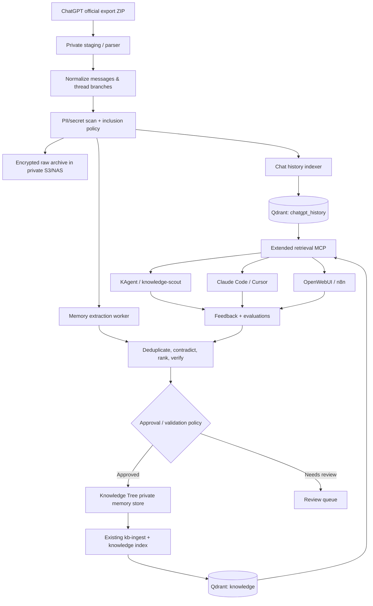
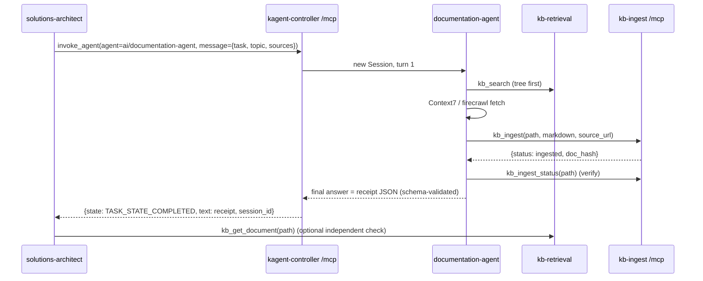

# Knowledge Tree: ChatGPT Conversation Import & Agent Memory Plan

**Project:** [`teaglebuilt/knowledge-tree`](https://github.com/teaglebuilt/knowledge-tree)  
**Status:** PR 1 + PR 2 implemented (untested — see §15.7), plus `kb_ingest` MCP + documentation agent (§15). PRs 3–5 still proposed.  
**Prepared:** November 7, 2026  
**Primary goal:** Turn exported ChatGPT conversations into verifiable, useful, long-term context for KAgent and other assistants without building a competing knowledge platform.

---

## 1. Executive decision

Extend the existing **knowledge-tree** platform rather than introducing a separate memory stack.

- **Keep** the Git-backed Markdown/Obsidian knowledge tree, local LanceDB + DuckDB pipeline, Qdrant cluster index, `kb-ingest` write API, and `kb-retrieval` MCP server.
- **Add** an importer for ChatGPT conversation exports and a separate, protected archive index for unprocessed historical conversations.
- **Add** a memory extraction, verification, reconciliation, and promotion workflow that turns conversations into durable facts, decisions, procedures, preferences, and incident lessons.
- **Keep** KAgent's own session/agent memory, if configured, as a supplementary working-memory layer; use knowledge-tree MCP for shared cross-agent knowledge.
- **Defer** Mem0, Graphiti, a knowledge graph, and a new PostgreSQL service until evaluations demonstrate a concrete gap.

**Important:** Importing data does **not** train or fine-tune the underlying LLM. This improves responses through retrieval, context engineering, and feedback. Model training is a separate future option.

### Desired outcome

Given a request such as:

> "Create an automated recovery workflow for `mlops-work-00` when GPU connectivity breaks."

A KAgent worker should retrieve relevant **confirmed** architectural details and validated runbooks from `knowledge-tree`, use historical conversations as supporting context when needed, and explicitly distinguish old discussions from current cluster state.

---

## 2. Current repository baseline

The following components are present in the repository as inspected on the `master` branch on November 7, 2026. Paths and behavior are grounded in the repository; proposed additions are distinguished below.

| Existing path | Observed purpose | Plan |
| --- | --- | --- |
| `README.md` | Obsidian/Git knowledge tree entry point | Update usage instructions |
| `docs/architecture.md` | Local-to-cluster indexing architecture | Extend diagram and data flows |
| `tree/branches.yaml` | Knowledge routing/build and encryption policy | Add memory branches as appropriate |
| `kb/chunk.py` | Markdown frontmatter and heading-aware overlapping chunks | Reuse for promoted Markdown, add transcript-aware splitting as needed |
| `kb/config.py` | Embeddings, Qdrant, source/index configuration | Add archive collection and privacy configuration |
| `kb/ingest_api/app.py` | HTTP endpoints `/ingest`, `/exists`, `/delete` | Reuse for *approved* knowledge writes; harden auth |
| `kb/ingest_api/service.py` | Incremental embed/upsert into Qdrant; `path` ownership | Reuse carefully; add metadata and access constraints |
| `kb/mcp_retrieval/server.py` | MCP tools `kb_search`, `kb_get_document` | Extend retrieval with history/memory tools. Stays read-only (§15.2) |
| `kb/ingest_api/mcp_tools.py` | **NEW** MCP tools `kb_ingest`, `kb_ingest_status` served at `kb-ingest:/mcp` | Agent write plane (§15) |
| `kb/mcp_retrieval/store.py` | Qdrant read-side search / full document retrieval | Add dedicated history store and filters |
| `kb/sync.py` | LanceDB → Qdrant synchronization; prunes `source_type=tree` | Preserve existing pruning isolation |
| `kb/adapters/qdrant.py` | Qdrant connection, collection, payload indexes, IDs | Extend for archive collection; honor separate auth policies |
| `chart/values.yaml` | Helm configuration for `kb-retrieval`, optional `kb-ingest`, agent | Add controlled config and optional importer Job |
| `chart/templates/agent.yaml` | KAgent `knowledge-scout-agent` template | Update agent's available tools/policy as compatible with deployed version |
| `Makefile` | `make ingest`, `reindex`, `sync`, `golden`, deploy targets | Add `import-chatgpt`, `extract-memories`, validation targets |

### Current behavior and constraints to preserve

1. Existing Qdrant collection defaults to **`knowledge`** and uses **`BAAI/bge-small-en-v1.5`**, **384 dimensions**. Do not change the vector model or dimension of the existing collection without an explicit reindex/migration.
2. The current write plane accepts JSON with `path`, `markdown`, `source_type`, `source_url`, `force` and stores chunked Markdown in Qdrant.
3. Existing `kb_search` supports `query`, `k`, `path`, `source_type`, and returns citeable chunks. `kb_get_document` pages through an indexed document.
4. Current `kb/sync.py` prunes *only* `source_type=tree` records. New imported sources must not be given that type unintentionally.
5. In `kb/ingest_api/app.py`, an unset `KB_INGEST_TOKEN` allows all callers that can reach the service to write. **Fix this before importing private history.**
6. Repository `master` is **public**. Do not commit raw personal conversations, secrets, sensitive memories, or private extracted notes to `tree/` without intentional classification and protection.
7. Helm chart values contain both `mcpServer` and `ingest` sections; validate their rendered manifests and the deployed KAgent CRD version before changing resource schemas.
8. Retrieval currently uses vector similarity against Qdrant, not a proven hybrid BM25+vector search in the deployed MCP path. Hybrid retrieval is a future improvement to measure.

Useful references: [Architecture](https://github.com/teaglebuilt/knowledge-tree/blob/master/docs/architecture.md), [Write-plane API](https://github.com/teaglebuilt/knowledge-tree/blob/master/kb/ingest_api/app.py), [Write service](https://github.com/teaglebuilt/knowledge-tree/blob/master/kb/ingest_api/service.py), [MCP server](https://github.com/teaglebuilt/knowledge-tree/blob/master/kb/mcp_retrieval/server.py), [Helm values](https://github.com/teaglebuilt/knowledge-tree/blob/master/chart/values.yaml).

---

## 3. Target architecture



### Storage separation

| Store | Data | Intended access | Retention |
| --- | --- | --- | --- |
| Private object storage, e.g. S3/NAS | Original ZIP, normalized JSONL, redaction audit, checkpoints | Ingestion/admin only | Explicit retention policy |
| Qdrant `chatgpt_history` | Searchable conversation/message chunks + provenance | Restricted historical retrieval, per-user access | Until deletion/retention rules apply |
| Existing Qdrant `knowledge` | Existing indexed docs; approved memories only | Knowledge MCP with policy filtering | Existing policy / revision management |
| Git-backed public `tree/` | General non-sensitive reference material | Existing Git workflow | Versioned in Git |
| Private memory records (design choice: encrypted private folder/object store) | Personal/project-specific accepted memories, revisions and approval state | User- and project-scoped | Explicit deletion + supersession policy |

**Design choice:** Do not treat a public Git repository as the source of truth for private memory. Store private memory Markdown or JSON outside the public checkout, with optional publishing of sanitized, expressly approved knowledge into `tree/`.

---

## 4. Data model and source provenance

### 4.1 Raw conversation record

Capture at least:

```json
{
  "source": "chatgpt_export",
  "export_id": "sha256:...",
  "conversation_id": "...",
  "conversation_title": "KAgent memory import",
  "created_at": "2026-11-06T00:00:00Z",
  "updated_at": "2026-11-07T00:00:00Z",
  "message_id": "...",
  "parent_message_id": "...",
  "role": "user",
  "message_created_at": "2026-11-06T00:00:00Z",
  "content_type": "text",
  "content": "...",
  "thread_id": "...",
  "project": "homelab",
  "privacy_class": "private",
  "redaction_version": "v1",
  "content_sha256": "..."
}
```

Treat this as a **logical schema**, not a promise that every ChatGPT export exposes every field. Missing values must be nullable. Store unmodified raw records separately for provenance and audit.

### 4.2 Derived durable memory record

```yaml
id: decision-kagent-claude-code-runtime-separation
kind: architectural_decision
owner_scope: personal
project: homelab
summary: >-
  Claude Code subagents are used for development-time engineering;
  KAgent is used for deployed runtime/operational agents.
status: proposed  # proposed | confirmed | rejected | superseded
confidence: 0.92  # extraction confidence, not proof
valid_from: null
valid_to: null
supersedes: null
source:
  system: chatgpt
  conversation_id: "..."
  message_ids: ["..."]
evidence:
  - type: conversation
    ref: "..."
verified_by: null
verified_at: null
privacy_class: private
tags: [kagent, claude-code, architecture]
```

### 4.3 Memory categories

- **Semantic:** persistent facts about projects or enduring preferences.
- **Episodic:** previous incidents, work sessions, and observed outcomes.
- **Decisions:** accepted, rejected, and superseded architecture decisions, with rationale.
- **Procedural:** validated runbooks, workflows, and reusable lessons.
- **Historical:** searchable original source conversations, not automatically trusted as facts.

Required behavior: distinguish **user-confirmed claims** from assistant suggestions, intentions from implementations, and old decisions from current state. Historical chats cannot establish the current condition of the cluster.

---

## 5. Proposed repository changes

```text
knowledge-tree/
├── kb/
│   ├── sources/
│   │   ├── __init__.py
│   │   └── chatgpt.py                 # NEW: export parser and normalizer
│   ├── memory/
│   │   ├── __init__.py
│   │   ├── models.py                  # NEW: memory schemas
│   │   ├── extract.py                 # NEW: conversation -> candidate memories
│   │   ├── reconcile.py               # NEW: dedupe/conflicts/supersession
│   │   ├── approve.py                 # NEW: promotion/review state
│   │   └── retrieval.py               # NEW: ranked memory/context assembly
│   ├── archive/
│   │   ├── __init__.py
│   │   └── chatgpt_store.py           # NEW: dedicated Qdrant archive operations
│   ├── mcp_retrieval/
│   │   ├── server.py                  # EXTEND: new read tools
│   │   ├── service.py                 # EXTEND: routed search
│   │   └── store.py                   # REUSE: knowledge collection
│   ├── ingest_api/
│   │   ├── app.py                     # HARDEN: auth, size limits, audit
│   │   └── service.py                 # EXTEND: metadata policy if needed
│   └── config.py                      # EXTEND: collection/privacy settings
├── scripts/
│   └── import_chatgpt.py              # NEW: CLI entry point
├── tests/
│   ├── fixtures/chatgpt/             # NEW: synthetic ZIP/JSON examples
│   ├── test_chatgpt_import.py         # NEW
│   ├── test_memory_extract.py         # NEW
│   ├── test_memory_reconcile.py       # NEW
│   ├── test_memory_retrieval.py       # NEW
│   └── test_memory_permissions.py     # NEW
├── eval/
│   └── chatgpt_memory.yaml            # NEW: recall and correctness dataset
├── docs/
│   ├── chatgpt-import.md              # NEW: user/admin runbook
│   └── memory-architecture.md         # NEW: design, trust rules, deletion
├── chart/
│   ├── values.yaml                    # EXTEND
│   └── templates/                    # OPTIONAL: import CronJob/Job + secrets
└── Makefile                           # EXTEND
```

**Note:** Directory names above are proposed. First inspect the current test/packaging layout before creating files, and match its conventions.

---

## 6. Implementation phases

### Phase 0 — Baseline, security and controls

**Goal:** Prove that private history can be handled safely without changing existing retrieval behavior.

- [ ] Create a feature branch and document the existing working `make ingest`, `make sync`, `make golden`, and Helm deployment behavior.
- [ ] Record existing Qdrant collection configuration and take a verified backup/snapshot.
- [ ] Confirm whether `kb-ingest` and `kb-retrieval` require auth in actual deployed manifests; require authenticated writes to ingest/delete endpoints.
  - [x] Code: writes fail closed when `KB_INGEST_TOKEN` is unset (`KB_INGEST_ALLOW_ANONYMOUS=true` only for local `make ingest-api`); constant-time compare; body cap `KB_INGEST_MAX_BODY_BYTES`; reserved `source_type`s (`tree`, `chatgpt*`, `memory`) rejected on every writer.
- [ ] Apply network policies and least-privilege service identities, including authorization for both history and accepted-memory retrieval.
- [ ] Configure private object storage for exports and checkpoints; enable encryption and private bucket policy.
- [ ] Define a data inclusion/exclusion policy: personal, confidential, work-related, third-party data, secrets, credentials, and copyrighted source material.
- [ ] Specify deletion behavior for raw source, derived vector points, promoted memories, snapshots, and backups.
- [x] Add test fixtures with fabricated conversations; never put real exports in source control or CI logs. (`tests/fixtures/chatgpt/`)

**Done when:** Security controls, backup, data policy, and an empty archive collection exist; existing services still pass baseline tests.

### Phase 1 — Official ChatGPT ZIP importer

**Goal:** Deterministically import history with reliable threading and provenance.

- [ ] Obtain export through ChatGPT **Settings → Data controls → Export data**.
- [x] Support ZIP archives containing `conversations.json` and numbered `conversations-*.json` files when present; inspect actual file names rather than assuming one layout.
- [x] Traverse the conversation mapping/tree using parent-child links and the conversation's current-node semantics when available; preserve alternate branches without inventing chronological relationships.
- [x] Normalize supported text content and roles; record non-text or unsupported elements rather than silently dropping them.
- [x] Preserve conversation IDs, message IDs, timestamps, titles, parent IDs, and source archive ID.
- [x] Redact credentials and other prohibited content *before* generating embeddings or sending content to any external LLM.
- [x] Tag private, project-specific and sensitive topics for scoped indexing; exclude unwanted categories. (`--policy` YAML: `exclude_titles`, `exclude_ids`, `projects`, `default_privacy` — regex on titles only; content classification is PR 3.)
- [x] Generate stable IDs (source + conversation + message/branch + content version); support reimport without duplicates.
- [x] Implement dry-run mode with counts, classification distribution, skipped elements, and estimates.
- [ ] Store source objects and parsed JSONL in encrypted private storage. (Partial: normalized JSONL + checkpoint go to `KB_ARCHIVE_DIR`, default `~/.local/share/kb/archive`, mode 0700/0600, refused if inside the repo. Encryption at rest is the storage's job — FileVault / SSE on the S3 bucket. The raw ZIP is not copied.)
- [x] Index only approved normalized content into Qdrant `chatgpt_history`, with appropriate indexed filter fields.
- [x] Add incremental checkpoints and restart/retry logic. Do not rely solely on historical timestamps to identify edits.

**Command contract (implemented):**

```bash
make import-chatgpt FILE="$HOME/Downloads/chatgpt-export.zip" DRY_RUN=1
make import-chatgpt FILE="$HOME/Downloads/chatgpt-export.zip" POLICY=~/kb-policy.yaml
make import-chatgpt FILE=... PRUNE=1          # full export only: drop conversations no longer present
# == uv run python -m kb import-chatgpt FILE [--dry-run] [--policy P] [--prune] [--limit N]
```

Implementation map: `kb/sources/chatgpt.py` (parse/normalize/policy), `kb/sources/redact.py`
(pattern redaction, versioned), `kb/archive/chatgpt_store.py` (Qdrant `chatgpt_history`,
message-level fingerprint upsert), `kb/import_chatgpt.py` (pipeline + checkpoint). The story's
`scripts/import_chatgpt.py` became a `kb` subcommand to match the repo's CLI convention.

**Done when:** A sample export imports without duplicate entries on repeated runs; branches and metadata are preserved; excluded content is not embedded; interrupted imports resume safely.

### Phase 2 — Extract durable memory

**Goal:** Convert conversations to concise candidate memories with evidence.

- [ ] Build an extractor that operates at conversation/topic level and can use your existing AI Gateway to select a model.
- [ ] Extract facts, architecture decisions, preferences, incidents, verified outcomes, procedures, and rejected options.
- [ ] Require source message references in every generated memory; reject unsupported assertions.
- [ ] Separate user statements from assistant-generated suggestions and unconfirmed technical advice.
- [ ] Classify each candidate as `proposed`, `confirmed`, `rejected`, or `superseded` as evidence permits.
- [ ] Detect contradicting facts and revisions; do not overwrite an old decision without recording the supersession.
- [ ] Merge duplicates while preserving all corroborating source references.
- [ ] Use an approval queue for private, high-impact, low-confidence, or otherwise ambiguous candidates.
- [ ] Save only confirmed/safe candidate memories to a protected, versioned private store; do not immediately commit them to public `tree/`.
- [ ] Promote sanitized, approved general-purpose knowledge through the existing Markdown ingestion route.

**Suggested commands:**

```bash
make extract-memories SOURCE=chatgpt DRY_RUN=1
make review-memories
make promote-memories
```

**Done when:** Candidate memories can be traced to exact source message IDs; a confirmed memory can be retrieved; a rejected item cannot silently reappear as confirmed upon reimport.

### Phase 3 — MCP retrieval and KAgent integration

**Goal:** Give agents context on demand without flooding prompts with history.

Preserve existing tools:

- `kb_search(query, k, path?, source_type?)`
- `kb_get_document(path, offset?, limit?)`

Add proposed tools:

| Tool | Behavior | Access |
| --- | --- | --- |
| `kb_recall(query, project?, kinds?, limit?)` | Return relevant approved memories and citations | Read-scoped |
| `kb_search_conversations(query, project?, date_range?, limit?)` | Search raw historical archive with provenance and warning that history is unverified | Restricted read |
| `kb_get_conversation(conversation_id, message_range?)` | Fetch a bounded conversation segment, not an unbounded transcript | Restricted read |
| `kb_propose_memory(memory)` | Stage memory for deduplication, checks and approval | Authorized write |
| `kb_ingest(path, markdown, source_url, ...)` | **Implemented (§15).** Store public documentation under `tree/docs/`; returns a receipt | Write — `kb-ingest` server only |
| `kb_ingest_status(path)` | **Implemented (§15).** `exists` + `doc_hash` for completion checks | Write server (read-only call) |
| `kb_review_memory(id, action)` | Approve, reject, supersede or delete according to permissions | Privileged control |

Implementation notes:

- [ ] Route retrieval to the correct collection using server-side, authenticated scopes; do **not** take a user-supplied arbitrary collection name.
- [ ] Filter by user/tenant, project, privacy class, validity, and approval state **before** returning data.
- [ ] Index needed payload fields in Qdrant; use strict ownership checks rather than trusting arbitrary metadata supplied by agents.
- [ ] Perform relevance ranking and token budgeting; prefer confirmed memory and current authoritative sources, then older conversation excerpts.
- [ ] Return timestamps, source IDs, confidence/status, and enough citation metadata for the agent to verify claims.
- [ ] Provide a policy to use `kb_recall` at the start of relevant tasks and raw-history lookup only when needed.
- [ ] Verify deployment against the *installed* KAgent CRDs; chart currently uses `api.kagent.dev/v1alpha3` for the agent and `kagent.dev/v1alpha1` for the MCP server configuration.
- [ ] Connect any design-time Claude Code or OpenWebUI integrations to the same MCP read plane rather than replicating state.

**Done when:** A KAgent task retrieves a relevant approved memory, can cite its source, cannot see unauthorized history, and correctly falls back when no memory applies.

### Phase 4 — Reconciliation, evaluation and feedback

**Goal:** Demonstrate better answers rather than just more retrieved text.

- [ ] Build a golden evaluation set from real but sanitized questions: historical recall, prior decisions, incident recovery, current-vs-old architecture, and rejected proposals.
- [ ] Compare **no memory**, **raw history only**, **distilled memory only**, and **distilled + on-demand history** variants.
- [ ] Evaluate retrieval Recall@k, MRR, citation correctness, contradictory-memory rate, answer accuracy, token use, latency and estimated cost.
- [ ] Track whether an agent used an irrelevant memory, missed a relevant one, or treated an unverified historical statement as current truth.
- [ ] Add explicit helpful/not-helpful feedback with a reason and optional correction.
- [ ] Store agent execution lessons as *proposed* memories; promote only after validation.
- [ ] Review aging facts periodically; for operational state, verify against live Kubernetes/GitHub tooling instead of trusting historical memory.

**Done when:** Evaluations show reproducible, positive improvement over the no-memory baseline with acceptable privacy risk and token/latency budgets.

### Phase 5 — Production hardening and lifecycle

- [ ] Add resource requests/limits and appropriate node scheduling for ingestion Jobs; keep bulk import separate from the interactive MCP service.
- [ ] Add Prometheus metrics: processed messages, skipped messages, extraction acceptance ratio, archive retrieval latency, failure/retry rates, duplicate suppression, and redaction events (counts only).
- [ ] Add tracing without logging raw conversation content or secrets.
- [ ] Add retention controls, authenticated deletion and verification that derived records are removed from live indexes and appropriate backups.
- [ ] Version embedding model and extractor prompts; provide schema/index migration tooling.
- [ ] Document disaster recovery: S3 archive → normalization/re-extraction → collection rebuild, with validation.
- [ ] Consider periodic imports only if a permitted, reliable export feed is available. Do not assume ChatGPT has a supported, continuously syncing personal-chat API.

**Done when:** Backups, restore, rollout, rollback, observability, authorization and deletion are tested.

---

## 7. Key API changes

### Proposed history import API (optional)

For an initial local CLI, a new public HTTP endpoint is **not** necessary. The importer can write through a narrowly scoped internal service/client after validation.

If remote imports are eventually needed, prefer asynchronous import jobs with authentication, upload size limits, malware scanning, content-type checks, audit logs, and idempotency keys—not sending an arbitrary ZIP body to the existing `/ingest` Markdown endpoint.

### Proposed context response shape

```json
{
  "query": "How should we handle GPU worker recovery?",
  "memories": [
    {
      "id": "incident-gpu-worker-001",
      "kind": "episodic",
      "status": "confirmed",
      "summary": "Verified recovery procedure ...",
      "source": {
        "conversation_id": "...",
        "message_ids": ["..."]
      },
      "observed_at": "...",
      "verified_at": "..."
    }
  ],
  "conversation_matches": [],
  "warnings": ["Historical information may no longer match live cluster state."]
}
```

---

## 8. Retrieval policy for agents

Recommended retrieval priority when answering an engineering request:

1. **Current state from authoritative tools:** cluster APIs, GitHub code, active manifests, or live telemetry when relevant and permitted.
2. **Approved, in-scope memory:** current project decisions, validated runbooks, and stable preferences.
3. **Existing knowledge tree:** general engineering knowledge and reference docs.
4. **Raw ChatGPT history:** only when searching for prior rationale, unresolved discussions, context not already distilled, or citation evidence.

Never automatically feed an entire conversation into a prompt. Retrieve bounded passages, resolve conflicts, and enforce a context token budget. In case of conflict, prefer current verified evidence and explain the discrepancy.

---

## 9. Security and privacy non-negotiables

- **Never import full personal history into public Git or an unrestricted agent namespace.** The GitHub repository is public.
- Run secret scanning, PII classification, and opt-in exclusion **before embedding and before third-party model calls**.
- Keep embeddings and payloads protected: vectors can still expose sensitive information through retrieval.
- Maintain user/project authorization across Qdrant collections, MCP tools, ingestion workers and promoted documents.
- Use a trust boundary around transcript content: historic chat text is **data**, not system instructions or executable code.
- Block prompt-injection attempts that ask the importer or retriever to ignore policy, reveal secrets, or execute commands.
- Require explicit approval for knowledge-tree publication and privileged memory changes.
- Make deletion comprehensive and testable, including derived chunks and backups under the chosen retention policy.
- Use safe logs and metrics; avoid writing raw prompts, secrets, or entire conversations to tracing backends.
- Preserve a redaction-version audit so changes can trigger reprocessing.

---

## 10. Test and acceptance matrix

| Test | Expected result |
| --- | --- |
| Export ZIP has one `conversations.json` | Successfully parse |
| Export has multiple numbered conversation files | Detect and import them |
| Thread contains edited/alternate branches | Preserve parent IDs and distinct branches |
| Message has missing timestamp or unsupported attachment | Preserve metadata/null or skip with audited reason |
| Same export imported twice | No duplicate indexed records |
| Export revised and imported again | Update changed items and remove or tombstone stale items as policy requires |
| API key or secret occurs in chat | Redacted/excluded before embedding |
| Unauthorized agent requests another user's history | Denied |
| Conversation contradicts an active cluster manifest | Active verified state wins; conflict is visible |
| Assistant suggested an approach but user never confirmed | Memory stays `proposed` |
| Previously accepted decision is reversed | Prior memory remains auditable as `superseded` |
| `make sync` runs after import | Historical records are not pruned |
| MCP search returns history | Source/branch/message provenance available |
| Delete conversation request | All relevant live archive and derived records removed |
| Cluster recovery from backup | Collections and approval states are reproducible |
| Golden evaluation comparison | Accuracy/relevance improvement measured objectively |

---

## 11. Delivery order / suggested pull requests

| PR | Scope | Dependencies |
| --- | --- | --- |
| **PR 1 — Private history foundations** | Auth hardening, archive collection config, privacy policy, synthetic fixtures | None |
| **PR 2 — ChatGPT importer** | ZIP parser, normalization, redaction, idempotent Qdrant import, CLI | PR 1 |
| **PR 3 — Extraction and reconciliation** | Candidate memory schemas, extractor, conflict handling, private storage, review | PR 2 |
| **PR 4 — Memory retrieval MCP** | Scoped archive search, verified recall, KAgent/Claude Code integration | PR 3 |
| **PR 5 — Eval and lifecycle** | Golden tests, telemetry, deletion, backup/restore, runbooks | PRs 1–4 |

**Minimum useful release:** PRs 1–2 plus a restricted historical search MCP tool.  
**Best agent-quality release:** PRs 1–4 plus the first measurable evaluation set.

---

## 12. Immediate action checklist

- [ ] Confirm availability of the official ChatGPT export ZIP locally.
- [ ] Snapshot Qdrant `knowledge` and record embedding model/version.
- [ ] Decide which history categories must be excluded from imports.
- [ ] Verify and enforce authenticated access to `kb-ingest` before private writes.
- [ ] Create a private `chatgpt_history` collection with separate access scope.
- [ ] Implement `scripts/import_chatgpt.py` + `kb/sources/chatgpt.py` with dry-run.
- [ ] Write synthetic fixtures covering branching, duplicate, missing, edited, and non-text messages.
- [ ] Run first small import, validate provenance, then execute a complete local import.
- [ ] Add memory candidates and the approval/reconciliation pipeline.
- [ ] Expose scoped retrieval through MCP and run the first controlled KAgent evaluation.

### First development task

> **Implement PR 1 and PR 2 inside `teaglebuilt/knowledge-tree` without altering existing `knowledge` collection semantics.** Include an idempotent, privacy-aware ChatGPT export importer, a separate `chatgpt_history` collection, dry-run reports, CLI wiring, and tests using synthetic conversation exports. Do not commit real personal history or enable unauthenticated writes.

---

## 13. Risks and decisions to revisit

| Decision | Recommendation now | Revisit when |
| --- | --- | --- |
| Mem0 | Do not add | Extraction/updates become complex enough to justify adopting it |
| Graphiti/graph DB | Do not add | Temporal and relationship queries consistently fail existing retrieval |
| PostgreSQL for memory | Do not add solely for this import | Structured metadata/transactions require stronger multi-user consistency |
| Separate Qdrant collections | Yes: `knowledge`, `chatgpt_history` | Only after authorization and query quality evaluation |
| Raw ZIP in Git | Never | Not applicable |
| Private memory in public `tree/` | No | Only sanitized, expressly approved publication |
| Automatic memory writes by runtime agents | Review first | Evals show reliable extraction and safe authorization |
| `kb_ingest` as a memory backdoor | Blocked: reserved source types, `tree/docs/` prefix, `documentation` type only | Never — memories go through `kb_propose_memory` |
| Agent-written docs only in Qdrant, not git | Accept for now (same as n8n YouTube) | Docs need Obsidian visibility → export job that opens a PR into `tree/docs/` |
| Continuous ChatGPT sync | Not assumed | Official supported export/sync capability becomes available |
| Fine-tuning on history | Not in initial scope | Retrieval-based approach plateaus and a justified, consented training dataset exists |

---

## 14. Definition of success

A successful implementation enables a KAgent or Claude Code agent to answer questions such as:

- "What did we previously decide about KAgent runtime agents versus Claude Code subagents?"
- "Find our earlier GPU passthrough troubleshooting discussion and the recovery steps that actually succeeded."
- "Which architectural approaches did we reject and why?"
- "What is the current runbook, and how is it different from our old discussion?"

It must do so with **relevant retrieval, exact provenance, safe access control, validated facts, and measured improvement**—not simply by storing more chat text.

---

## 15. Agent write plane (`kb_ingest`) and the documentation agent

Added on 2026-11-09. Scope: give agents a write counterpart to `kb_search`, and a
documentation agent other agents delegate "find docs" / "store docs" to. First
consumer: homelab `platform/ai/agents/solutions-architect`.

### 15.1 What the tool does

| Tool | Contract |
| --- | --- |
| `kb_ingest(path, markdown, source_url, title?, tags?, source_type="documentation", force=false)` | Chunk, embed and upsert one document into `knowledge`. Returns JSON `{status: ingested\|unchanged\|empty\|rejected\|failed, path, doc_hash, chunks, collection, source_url}` (`retryable: true` on infra failures). Same path + same body = `unchanged`, so retries are free. |
| `kb_ingest_status(path)` | `{path, exists, doc_hash}` — read it back to confirm a receipt. |

Agent policy, narrower than the HTTP plane n8n uses: path must start with
`KB_MCP_INGEST_PATH_PREFIXES` (`tree/docs/`), lowercase slug; `source_type` from
`KB_MCP_INGEST_SOURCE_TYPES` (`documentation`); `source_url` required; size cap
`KB_MCP_INGEST_MAX_BYTES` (512 KiB). Reserved types (`tree`, `chatgpt*`, `memory`)
are refused on every writer. So `kb_ingest` cannot be used to slip private memory
past the PR 3 approval pipeline.

### 15.2 Decision: `kb_ingest` is served by kb-ingest, not kb-retrieval

You asked for the tool "alongside `kb_search`". At the binding level that is what
happens: the documentation agent's template lists both servers. But the tool is
**not** on the kb-retrieval server:

1. **kagent's Claude harness ignores per-tool allowlists.** A binding on that
   harness exposes every tool the server serves ([About tools](https://kagent.dev/docs/kagent/latest/skills-and-mcp/about-tools/)).
   kb-retrieval is bound by solutions-architect, knowledge-scout and others, so a
   write tool there would turn every reader into a writer. What actually grants
   write access is which *server* you bind, not which tool names you list.
2. §Story acceptance "no write tools exposed on this server" and the scout's
   "NEVER expose write tools against the `knowledge` collection" both still hold.
3. kb-ingest already runs next to Qdrant (application cluster) and holds the write
   token. kb-retrieval runs on mlops with read credentials only.

Implementation: `kb/ingest_api/mcp_tools.py`, mounted at `/mcp` on the existing
kb-ingest Starlette app (stateless streamable HTTP, JSON responses). It is behind the
same token as `/ingest`, given as `Authorization: Bearer` or `X-KB-Ingest-Token`. The
second header exists because a kagent `headersFrom` copies a Secret value verbatim and
cannot add the `Bearer ` prefix. `tests/test_plane_separation.py` is the fitness
function that keeps this boundary in place.

### 15.3 Documentation agent

`chart/templates/docs-agent-template.yaml` (AgentTemplate `documentation`) and
`chart/templates/docs-agent.yaml` (Agent `documentation-agent`, EgressPolicy,
RemoteMCPServer `kb-ingest`). Both are gated on `agent.enabled` **and**
`docsAgent.enabled`. They use namespace `ai`, `harnessRef: kagent` and
`app.kubernetes.io/part-of: knowledge-tree`.

- **Tools:** `kb_search` and `kb_get_document` (tree first), `kb_ingest` and
  `kb_ingest_status`, Context7 (whole server, read-only), and firecrawl
  `search/extract/crawl/check_crawl_status`.
- **Protocol:** tree first → fetch (Context7 for libraries, firecrawl for sites) →
  store at most 10 docs at `tree/docs/<product>/<slug>.md` → verify each with
  `kb_ingest_status` → answer.
- **`outputSchema`:** the final answer is a schema-validated receipt
  `{status, task, summary, answer, documents[{path,status,doc_hash,chunks,source_url,verified}], citations, errors}`.
  kagent validates it before publishing. This needs the `kagent` harness with
  `golang-adk`, which homelab's `kagent` Harness uses. Set
  `docsAgent.structuredOutput=false` on other harnesses.

### 15.4 How the delegating agent knows the work is complete

This comes from the kagent 1.0 docs, read rather than assumed. kagent has three
delegation mechanisms, and they signal completion very differently:

| Mechanism | What the caller gets back | Completion signal | Fit here |
| --- | --- | --- | --- |
| **`subAgent` binding** ([agent-delegation](https://kagent.dev/docs/kagent/latest/examples/agent-delegation/)) | **Nothing.** "A subagent binding hands over the conversation rather than returning an answer… The parent does not receive the bound agent's output." The specialist keeps answering later turns in that Session. | None to the parent. The *user* sees the specialist's reply. | **Rejected** for agent-to-agent work. The bound template also compiles under the parent's Agent/Harness (same Actor, one nesting level, same namespace), so solutions-architect would need kb-ingest egress and the write token. That makes it a writer. |
| **kagent controller MCP `invoke_agent`** ([agents-via-mcp](https://kagent.dev/docs/kagent/latest/examples/agents-via-mcp/)) | Blocking `tools/call` returns `{session_id, task_id, context_id, state, text}` after the callee finishes its turn. | The tool call **returns**. `state == "TASK_STATE_COMPLETED"` is success; any other state is failure. `text` is the receipt JSON. | **Chosen** for agent callers. |
| **A2A + push callback** ([a2a-agents](https://kagent.dev/docs/kagent/latest/examples/a2a-agents/)) | A2A Task. Webhook fires on `INPUT_REQUIRED`, `AUTH_REQUIRED`, `COMPLETED`, `FAILED`, `CANCELED`, `REJECTED`. The receiver then calls `GetTask` for the artifacts. | Callback, then `GetTask`. | For **non-agent** callers (n8n, CI). An LLM agent cannot receive a webhook. Deliveries are unsigned until `controller.push.signing.secretName` is set. In-cluster receivers need `config.push.allowPrivateNetworks`. |

The caller should trust completion only when **all three layers** agree:

1. **Transport:** `invoke_agent` returned and `state` is `TASK_STATE_COMPLETED`.
   A timeout or a non-completed state is a failure and carries no receipt.
2. **Semantic:** the schema-validated receipt says `status: completed` (or
   `partial`, with `errors`).
3. **Data:** every `documents[].verified` is true. The documentation agent re-read
   each `doc_hash` after writing. The caller can check independently with its own
   read-only `kb_get_document(path)`. Qdrant upserts run with `wait=True`, so
   reads after a write are consistent.



**Long runs.** A blocking call is bounded by the caller's RemoteMCPServer
`timeout`. Two guards apply: the agent stores at most 10 documents per run, and big
crawls go asynchronous. For an async run, call `create_session(agent, message,
request_id)`, which "returns once the agent accepts the turn". Then poll
`get_session(session_id, last_turns=1)` until the turn has a reply. `request_id`
makes a retried create idempotent. The MCP tasks extension (`tasks/get`) is more
elegant, but only works when the *MCP client* declares it. Whether the kagent
harness's own MCP client does that is unverified, so do not depend on it.

### 15.5 Consumer contract for homelab solutions-architect

These changes go in `teaglebuilt/homelab`. They are not made from this repo:

```yaml
# platform/ai/kubernetes/mcp/kagent-agents.yaml
apiVersion: api.kagent.dev/v1alpha3
kind: RemoteMCPServer
metadata: {name: kagent-agents, namespace: ai}
spec:
  description: kagent controller MCP — invoke other agents and read their sessions
  protocol: STREAMABLE_HTTP
  url: http://kagent-controller.ai.svc.cluster.local:8083/mcp
  timeout: 600s
```

- solutions-architect `tools`: add `mcp: {server: {kind: RemoteMCPServer, name: kagent-agents}, tools: [invoke_agent, create_session, get_session]}`.
- solutions-architect EgressPolicy: add `http://kagent-controller.ai.svc.cluster.local:8083`.
  It does **not** need kb-ingest egress or the token, because it never writes.
- Prompt snippet: *"To fetch or persist documentation, call `invoke_agent` with
  agent `{namespace: ai, name: documentation-agent}` and a JSON message
  `{task, topic, question?, sources?, target_path?}`. Treat the work as done only
  if `state` is `TASK_STATE_COMPLETED` and the JSON in `text` has
  `status: completed`. Cite `documents[].path`. If it times out, do not retry
  blindly. Use `create_session` + `get_session`."*
- Secret `kb-ingest-token` (key `KB_INGEST_TOKEN`) must exist in `ai` on **mlops**.
  It holds the same value as the kb-ingest Deployment on application.

**Risk to accept or mitigate before go-live.** The controller MCP runs in `insecure`
auth mode by default. It trusts a caller-set `X-User-Id`, and `invoke_agent` can reach
**any** Agent the caller can see, not only `documentation-agent`. kagent bindings narrow
tools, not tool arguments. On the homelab trusted network this is the same exposure the
kagent UI already has. If that is not acceptable, put the controller behind
agentgateway with an authz rule on the `agent` argument, or enable real controller auth.

### 15.6 Files

| Path | Change |
| --- | --- |
| `kb/ingest_api/mcp_tools.py` | NEW `kb_ingest`, `kb_ingest_status` |
| `kb/ingest_api/app.py` | `/mcp` mount, fail-closed auth, body cap, `X-KB-Ingest-Token` |
| `kb/ingest_api/service.py` | reserved `source_type` refusal |
| `kb/config.py` | MCP ingest policy, archive collection/dir, redaction version |
| `kb/sources/chatgpt.py`, `kb/sources/redact.py` | NEW parser/normalizer, redaction |
| `kb/archive/chatgpt_store.py` | NEW `chatgpt_history` store |
| `kb/import_chatgpt.py`, `kb/__main__.py`, `Makefile` | NEW `import-chatgpt` command, `make test` |
| `chart/values.yaml`, `chart/templates/ingest.yaml` | `docsAgent.*`, `ingest.mcp.*`; HTTP prefixes narrowed to `tree/youtube/,tree/docs/` (read-plane follow-up 2) |
| `chart/templates/docs-agent-template.yaml`, `docs-agent.yaml` | NEW documentation agent |
| `tests/` | NEW synthetic fixtures + import, MCP-ingest and plane-separation tests |

### 15.7 Verification status

Nothing here has been run yet. Per house policy, execution and tests go to a Haiku
pass: `make test`, `helm template chart` (and again with
`--set docsAgent.structuredOutput=false`), then on the cluster `kubectl get remotemcpserver kb-ingest -n ai -o jsonpath='{.status.discoveredTools[*].name}'`.
Known soft spots to watch: the MCP SDK's stateless-mode handling of `initialize`
in `test_mcp_lists_and_calls_kb_ingest`, and qdrant-client `:memory:` support for
payload indexes.

Ingest behaviour also changed: any kb-ingest deployed **without** a token Secret
now refuses writes. The chart default `tokenSecret: kb-ingest-token` already sets
one, but the n8n workflow must send it.

---

*Repository snapshot reviewed: `teaglebuilt/knowledge-tree`, `master`, November 7, 2026. This document is a recommended design and rollout plan; it does not assert that these new features have already been implemented.*
